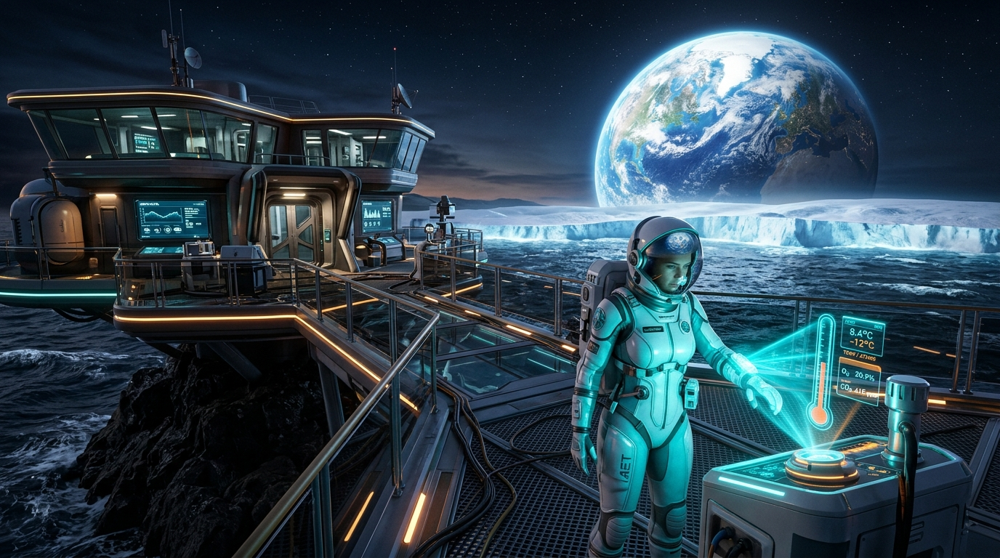
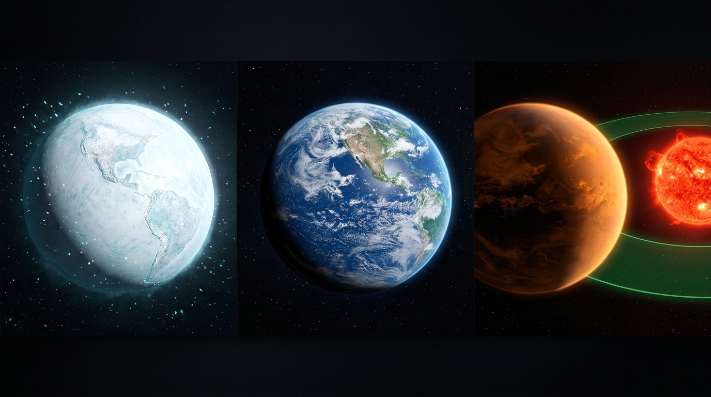
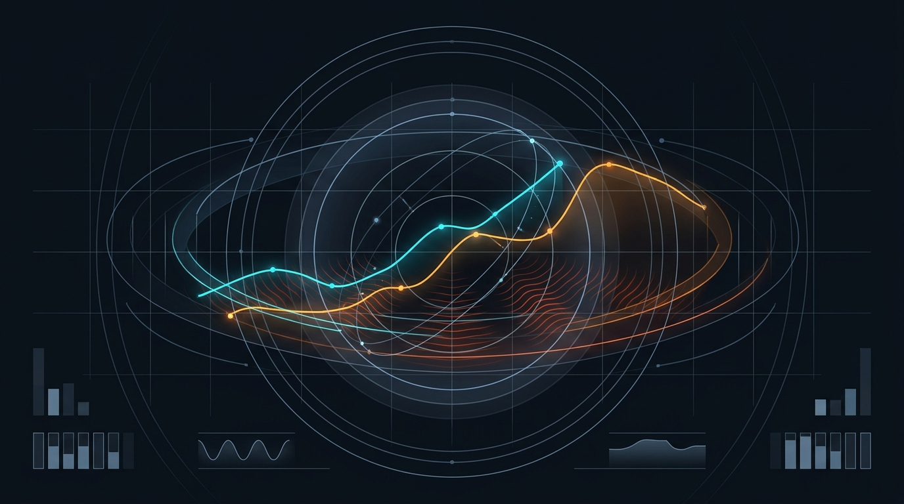
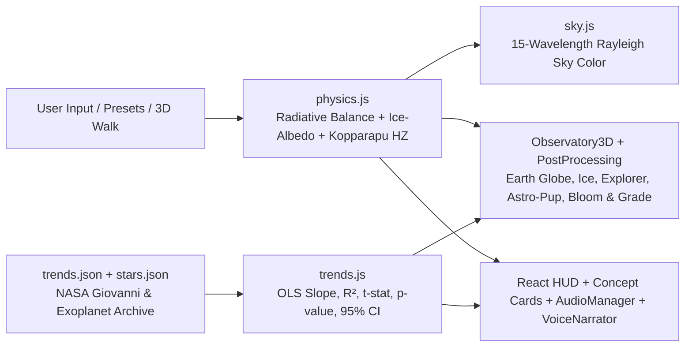

<div align="center">

<table border="0" cellspacing="0" cellpadding="0">
  <tr>
    <td align="center" valign="middle">
      
    </td>
    <td align="left" valign="middle">
      <h1 style="margin: 0;">TerraWhatIf: Earth System Trend Detective</h1>
      <strong>Interactive 3D Coastal Climate Observatory &amp; Planetary Habitability Simulator</strong><br />
      Built for <strong>NASA Space Apps Challenge 2026</strong> — <em>"Be An Earth System Trend Detective!"</em>
    </td>
  </tr>
</table>

<br />

[](https://terrawhatif.vercel.app/)
[](https://youtu.be/UJOP3UULW7k?si=Q1ojv7IexKQncfEa)
[](https://www.spaceappschallenge.org/)
[](https://react.dev/)
[](https://threejs.org/)
[](https://www.typescriptlang.org/)

<br />



</div>

<br />

**TerraWhatIf** is an interactive 3D web science experience that unifies **third-person 3D observatory exploration**, **calibrated first-order radiative-balance physics**, and **NASA Giovanni satellite trend analysis (2003–2025)**.

Instead of reading static climate graphs, explorers step onto a cinematic coastal climate observatory deck alongside their **astro-pup companion** and AI science copilot **TERRA**, walk across the platform to scan 3D scientific instruments, test planetary hypotheses through interactive prediction quizzes, and watch Earth's atmosphere, ocean mist, polar ice, sky optics, and orbital globe respond live in real time.

---

## Why TerraWhatIf? (Challenge Alignment)

| Pillar | How TerraWhatIf Delivers |
| :--- | :--- |
| **Real NASA Science** | Calibrated to **NASA CERES EBAF** radiative balance (`340 W/m²`, `A = 0.30`, `288 K`), **NASA Giovanni (MERRA-2 & AIRS)** 2003–2025 regional trends, and **NASA Exoplanet Archive** **TRAPPIST-1** stellar & orbital data. |
| **Experiential 3D Learning** | Walkable coastal observatory with **8 interactive 3D instruments**, a holographic wrist-scanner, a curious **astro-pup companion** in a bubble helmet, and a **7-step point-out Feature Tour**. |
| **Rigorous Math + Accessible Intuition** | Every instrument opens a 3-layer **Look! → Why? → Math & NASA Data** card pairing everyday analogies with live SI equations and real-time OLS regression (`slope`, `R²`, `t-stat`, `p-value`, `95% CI`). |

---

## Planetary Climate States at a Glance

<div align="center">
  
  <p><sub><strong>Left:</strong> Ice-Albedo Snowball Freeze (<code>-18°C</code> airless / low CO₂) &nbsp;·&nbsp; <strong>Center:</strong> Earth Baseline (<code>+15°C</code>, liquid oceans) &nbsp;·&nbsp; <strong>Right:</strong> Exoplanet <strong>TRAPPIST-1 e</strong> (sunset-amber Rayleigh sky &amp; Habitable Zone ring)</sub></p>
</div>

---

## Key Features

### 1. Cinematic 3D Observatory, Explorer & Astro-Pup Companion
- **Moody Film-Grade WebGL Pipeline**: Three-point golden-amber key & cool atmospheric rim lighting, `PCFSoftShadowMap` real-time shadows, procedural normal/roughness PBR textures, exponential horizon fog, selective HDR `UnrealBloomPass`, and a custom `CinematicGradeShader` (35mm film grain, vignette, warm/teal grading, and subtle tilt-shift).
- **Walkable Explorer + Astro-Pup Companion**: Move across the deck and elevated piers using `W A S D` / Arrow keys (or the mobile touch D-Pad). Your **astro-pup**—complete with space bubble helmet, sensor harness, wagging tail, and blinking eyes—trots beside you, tilts its head curiously when you scan instruments, and jumps joyfully with you when missions complete.
- **Cinematic Opening & 7-Step Feature Tour**: Opens with a 2-second orbital horizon sweep, typewriter transmission from **TERRA**, and a point-out onboarding spotlight tour covering every control (`Tour` button or `?`).
- **Dynamic 3D Climate Physics Visuals**:
  - **15-wavelength Rayleigh sky optics** shifting smoothly from Earth's *Azure Blue* to **TRAPPIST-1**'s *Sunset Amber*.
  - **Live weather particles**: drifting snowfall below freezing (`< 275 K`) and rising thermal embers during extreme heat (`> 315 K`).
  - **3D Spherical Earth** in the upper sky reflecting planetary ice cover & clouds, plus a **3D Mini Habitable Zone Hologram** above the Star Telescope.

### 2. Story-Driven 3-Chapter Mission Progression
Each chapter opens with a **Chapter Story Briefing** featuring animated typewriter narration, custom SVG science visuals, and adaptive music:

| Chapter | Title | Core Science Concept | Mission Goal |
| :--- | :--- | :--- | :--- |
| **Chapter 1** | **The Heat Blanket** | Natural greenhouse warming (`+33°C`) & Ice-Albedo feedback | Inspect Earth's Thermometer, Polar Ice, and Gas Valve, then raise `CO₂` past `560 ppm`. |
| **Chapter 2** | **Too Close to the Sun** | Inverse-square stellar flux ($1/d^2$) & water-vapor feedback | Answer TERRA's prediction quiz, pull Earth inward to `0.85 AU` (`+38%` sunlight), and rebalance temperature below `47°C`. |
| **Chapter 3** | **Red Sun TRAPPIST-1** | M-dwarf luminosity, Kopparapu Habitable Zone & tidal locking | Switch host star to **TRAPPIST-1**, find the green Habitable Zone (`~0.029 AU`), and inspect the amber sky and Day-Night terminator. |

### 3. Intuitive Learning, Quizzes & Instant What-If Presets
- **3-Tab *Touch to Understand* Cards**: All 8 deck landmarks (`Thermometer`, `Polar Ice`, `Gas Valve`, `Orbit Lever`, `Ocean Mist`, `Star Telescope`, `Sky Dome`, `Day-Night Line`) reveal:
  1. **Look!** — Direct visual cues in the 3D observatory.
  2. **Why?** — Everyday analogies explaining the physics.
  3. **Math & NASA Data** — Live equations, telemetry readouts, and NASA mission comparisons.
- **Interactive Prediction Quizzes (`CH1`–`CH3`)**: Prompts hypothesis-first thinking before testing parameters in 3D.
- **1-Click *What-If Presets* & Live `vs. Earth` Delta Strip**: Jump straight into *Earth Today*, *Snowball Earth*, *2× CO₂ Future*, *Runaway Heat*, or *TRAPPIST-1 e*, and inspect live temperature/ice deltas against Earth baseline.

### 4. NASA Giovanni Data Explorer & Live 3D Replay (2003–2025)

<div align="center">
  
</div>

- **OLS Regression & Student's *t*-Test Engine (`trends.js`)**: Computes decadal slope, $R^2$, *t*-statistic, *p*-value, and 95% confidence intervals across four **NASA Giovanni (MERRA-2 & AIRS)** regional series:
  - *Arctic Surface Temperature* (66–90°N)
  - *Tropical Surface Temperature* (20°S–20°N)
  - *Arctic Sea-Ice Albedo*
  - *Tropical Water Vapor*
- **Animated Sparklines & Live 3D Replay**: Hovering the *Regional Trends* card animates the 2003–2025 regression sweep, and **`Play 2003→2025 in 3D`** replays 22 years of observed satellite progression live inside the 3D observatory.

### 5. Procedural Soundtrack, Calm Voice Narration & Celebrations
- **Continuous Calming Ambient Score (`AudioManager`)**: Zero-asset Web Audio synthesizer playing evolving `Cmaj9 → Am9 → Fmaj9 → G6sus4` pads, soft felt-piano notes, and climate-reactive coastal waves, arctic wind, or thermal crackles.
- **Occasional TERRA Voice Observations (`VoiceNarrator`)**: Calm Web Speech voice remarks during gameplay (with auto-ducking music and live italic captions in TERRA's card).
- **Joyful Mission Completion Celebration**: Finishing a chapter triggers celebratory arpeggios, happy astro-pup yips, a cheerful *"Yaay! Mission complete!"* voice cheer, and synchronized multi-jump animations from both the explorer and astro-pup.

---

## Architecture & Physics Engine



All climate physics run deterministically in SI units and are calibrated against **NASA CERES EBAF**:

1. **Stellar Flux & Equilibrium Temperature**:
   $$F = \sigma T_{\star}^4 \left(\frac{R_{\star}}{a}\right)^2, \qquad T_{\text{eq}} = T_{\star}\sqrt{\frac{R_{\star}}{2a}}(1 - A)^{1/4}$$
   Calibrated to $S_0 = 1361\text{ W/m}^2$, Bond albedo $A(288\text{ K}) = 0.30$, and airless equilibrium temperature $T_{\text{eq}} \approx 254.6\text{ K}$ (`-18.5°C`).
2. **Coupled Ice-Albedo Feedback**:
   $$A(T_s) = A_{\text{warm}} + (A_{\text{ice}} - A_{\text{warm}}) \cdot \frac{1}{2}\left[1 - \tanh\left(\frac{T_s - 273}{10}\right)\right]$$
   with $A_{\text{ice}} = 0.62$.
3. **Infrared Optical Depth ($\tau$) & Coupled Radiative Solver**:
   $$\tau_{\text{total}} = \tau_{\text{base}} + 0.13\ln\left(\frac{\text{CO}_2}{280}\right) + 0.015\left(\sqrt{\text{CH}_4} - \sqrt{700}\right) + \tau_{\text{H}_2\text{O},0}\,e^{0.07\,\Delta T}$$
   $$T_s = T_{\text{eq}}(A(T_s)) \cdot \left(1 + 0.75\,\tau_{\text{total}}\right)^{1/4}$$
   Solved via damped fixed-point iteration (50 steps, damping `0.5`), yielding a `+2–4 K` response for doubled $\text{CO}_2$ (`560 ppm`) and flagging the **Simpson–Nakajima runaway threshold** (`> 280 W/m²` absorbed flux).
4. **Habitable Zone Boundaries (*Kopparapu et al., 2013*)**: Computes conservative inner (*Runaway Greenhouse*) and outer (*Maximum Greenhouse*) orbital limits for both the Sun (`5772 K`) and **TRAPPIST-1** (`2566 K` from the **NASA Exoplanet Archive**).

---

## Tech Stack

| Layer | Technology |
| :--- | :--- |
| **UI Framework** | React 19 + TypeScript + Vite |
| **Styling & Typography** | Tailwind CSS v4 · `Chakra Petch`, `Plus Jakarta Sans`, `JetBrains Mono` |
| **3D Graphics & Post-FX** | Three.js (`WebGLRenderer`, `EffectComposer`, `UnrealBloomPass`, `ACESFilmicToneMapping`, `RoomEnvironment`) |
| **Physics & Statistics** | Zero-dependency pure ES modules (`physics.js`, `sky.js`, `trends.js`) |
| **Audio & Voice** | Procedural Web Audio Synthesizer (`AudioManager.ts`) + Web Speech Narrator (`VoiceNarrator.ts`) |
| **Icons & Diagrams** | Lucide React + Custom SVG Visualizations |

---

## Project Structure

```text
src/
├── App.tsx                       # Mission orchestration, 3D NASA replay, voice triggers, HUD & modals
├── audio/
│   ├── AudioManager.ts           # Continuous calming space pad, climate soundscapes, chimes & SFX
│   └── VoiceNarrator.ts          # Calm Web Speech observations & mission-complete cheer voice
├── engine/                       # Verified pure scientific & statistical modules
│   ├── physics.js                # Radiative balance, ice-albedo feedback & Kopparapu HZ solver
│   ├── physics.test.js           # Physics calibration test suite (10/10 assertions)
│   ├── sky.js                    # 15-wavelength Rayleigh spectral sky color engine
│   ├── trends.js                 # OLS linear regression, R², t-stat, p-value & 95% CI
│   ├── trends.json               # NASA Giovanni 2003–2025 regional series (MERRA-2 & AIRS)
│   ├── stars.json                # Stellar & exoplanet parameters (NASA Exoplanet Archive)
│   └── chapters.js & concepts.js # Chapter curriculum & concept definitions
├── scene3d/                      # Modular Three.js systems & cinematic rendering
│   ├── postprocessing.ts         # EffectComposer, selective HDR bloom, grain, vignette & grading
│   ├── environment.ts            # Sky dome, star, ocean, ice, mist, snow/embers & 3D Earth globe
│   ├── explorer.ts               # 3P astronaut rig, walk cycle, wrist scan beam & multi-jump cheer
│   ├── companion.ts              # 3D astro-pup pet in bubble helmet with trot, blink & celebration
│   ├── landmarks.ts              # 8 interactive deck instruments + mini 3D HZ orbit hologram
│   └── materials.ts              # Procedural canvas normal/roughness textures & PBR materials
├── data/                         # Narrative copy, gamification & math breakdowns
│   ├── badges.ts                 # Detective rank & 5-badge progression evaluator
│   ├── chapterStories.ts         # Multi-beat narrative intros per chapter
│   ├── kidCopy.ts                # Accessible Look! / Why? explanations
│   ├── mathBreakdown.ts          # Structured equations & live telemetry cards
│   ├── presets.ts                # 1-click What-If scenario presets
│   └── quests.ts                 # 3-step mission evaluator & intuitive step insights
└── components/                   # Modular React UI components
    ├── BrandMark.tsx             # Geometric orbital horizon emblem
    ├── FeatureTourOverlay.tsx    # Interactive 7-step point-out onboarding spotlight tour
    ├── Observatory3D.tsx         # WebGL canvas, 3-point lighting, HUD badges, waypoint & 3P controls
    ├── IntroBriefingCard.tsx     # Cinematic typewriter opening mission briefing
    ├── ChapterStoryModal.tsx     # Interactive chapter story viewer with typing & audio
    ├── NavigatorMissionCard.tsx  # Collapsible 3-step mission checklist with Tour/Story & focus actions
    ├── ControlDeck.tsx           # Target-marked sliders, vs. Earth delta strip, Reset & presets
    ├── ConceptCard.tsx           # 3-tab "Touch to Understand" card (Look! / Why? / Math & NASA)
    ├── GiovanniTrendsCard.tsx    # Animated NASA Giovanni sparklines, OLS t-test & 3D replay trigger
    ├── MiniPredictionModal.tsx   # Chapter 1–3 interactive prediction quizzes
    ├── DetectiveBadgesModal.tsx  # Detective rank & badge collection modal
    ├── MissionDebriefModal.tsx   # End-of-mission summary after Chapter 3 completion
    ├── ScienceLabView.tsx        # Open sandbox, full telemetry & model limitations
    ├── ControlsHelpModal.tsx     # Keyboard shortcuts, navigation guide & Tour replay
    ├── NotebookDrawer.tsx        # Discovery notebook (0/8 instruments)
    ├── StarSwitcherCard.tsx      # Host star switcher (Sun ↔ TRAPPIST-1)
    ├── RewardBanner.tsx          # Success/off-track explanation banner with quick Next CTA
    └── TerraAvatar.tsx           # Dynamic TERRA avatar responding to climate mood
```

---

## Getting Started & Controls

### Local Development
```bash
npm install
npm run dev                        # Start Vite dev server on port 3000
npm run lint                       # Run TypeScript check (tsc --noEmit)
npm run build                      # Build production bundle
node src/engine/physics.test.js    # Run calibrated physics test suite (10/10)
```

### Observatory Controls
| Input | Action |
| :--- | :--- |
| `W` `A` `S` `D` / Arrow Keys | Walk around the 3D observatory deck (astro-pup follows beside you; touch D-Pad on mobile) |
| `E` | Scan and inspect the nearest glowing instrument |
| `V` | Toggle between **Walking (3P)** mode and **Overview** camera |
| `H` | Hide or show all HUD panels for an unobstructed cinematic 3D view |
| `?` | Open the Controls, Shortcuts & Feature Tour guide |
| **Drag / Scroll** | Orbit the camera angle and zoom in/out |

---

## Scientific Data Credits & Transparency
- **NASA CERES EBAF**: Top-of-atmosphere solar flux (`340 W/m²`), global Bond albedo (`0.30`), and `288 K` baseline surface temperature calibration.
- **NASA Giovanni (GES DISC — MERRA-2 & AIRS)**: Regional 2003–2025 observational time series for Arctic & Tropical temperatures, Arctic sea-ice albedo, and tropical water vapor (benchmark series compiled with AI assistance modeled on authentic climatological records).
- **NASA Exoplanet Archive**: Stellar and orbital parameters for **TRAPPIST-1** and **TRAPPIST-1 e** (compiled with AI assistance from Composite Parameters).
- **NASA Insignia**: U.S. Government public-domain emblem included for NASA Space Apps Challenge 2026 attribution in project documentation.
